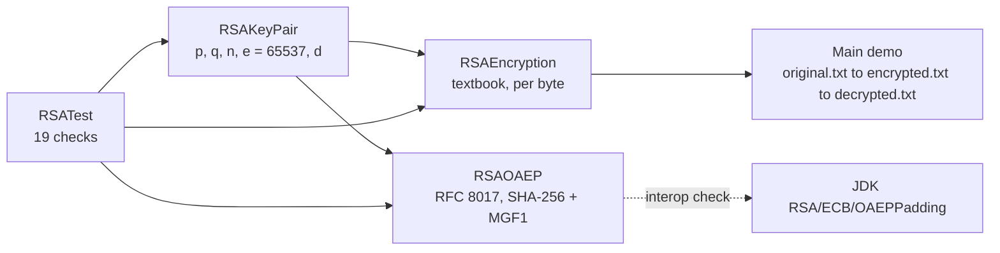

<div align="center">

# RSA in Java, from scratch

**Key generation, textbook RSA, and RSAES-OAEP (RFC 8017), built on `BigInteger.modPow` only.**
The OAEP padding is checked against the JDK's own implementation in both directions.

[](https://github.com/Abdelrahmanshaheen1/RSA-Java-Implementation/actions/workflows/test.yml)


[](LICENSE)

</div>

## At a glance

| | |
|---|---|
| **Textbook RSA** | Per-byte encrypt/decrypt, kept simple so every step is visible. Deterministic, so deliberately *not* secure |
| **RSA-OAEP** | SHA-256 + MGF1, random seed per message, one generic error for any bad ciphertext |
| **Interop** | Encrypts with this code and decrypts with the JDK's `RSA/ECB/OAEPPadding`, and the reverse, on the same key |
| **Run it** | `javac *.java && echo "512" \| java Main` |
| **Test it** | `java RSATest` (19 checks, no test framework) |

## Contents

[How the pieces fit](#how-the-pieces-fit) · [What it does](#what-it-does) · [Why textbook RSA fails, and what OAEP adds](#why-the-per-byte-scheme-is-not-secure-and-what-rsaoaep-adds) · [Run it](#run-it) · [Fixes made](#fixes-made-while-adding-the-tests) · [Limitations](#limitations) · [Layout](#repository-layout)

## How the pieces fit



## What it does

- **`RSAKeyPair`** — generates a public/private key pair for a given key length: picks two probable primes (`BigInteger.probablePrime`), computes the modulus `n` and Euler's totient `φ(n)`, fixes the public exponent `e = 65537`, and derives the private exponent `d` as the modular inverse of `e` mod `φ(n)`.
- **`RSAEncryption`** — encrypts/decrypts byte-by-byte: each byte is treated as `m`, encrypted as `c = m^e mod n`, and decrypted as `m = c^d mod n`, with file-level helpers to encrypt/decrypt a whole text file line by line.
- **`Main`** — prompts for a key length (minimum 256 bits), generates a key pair, encrypts `original.txt` to `encrypted.txt`, decrypts it back to `decrypted.txt`, and prints the keys and message at each stage (plaintext, encrypted, and decrypted) alongside their raw `BigInteger` byte representations — useful for seeing exactly what RSA is doing under the hood rather than treating it as a black box.

## Why the per-byte scheme is not secure (and what `RSAOAEP` adds)

`RSAEncryption` encrypts every byte on its own with no padding ("textbook RSA"). That keeps each step easy to follow, but it is deterministic: the same byte always produces the same ciphertext number, so the output is just a substitution cipher over 256 values and falls to frequency analysis. Run the demo and you will see the same big numbers repeat for every space and every `e`.

`RSAOAEP` is the fix used in practice: **RSAES-OAEP** (RFC 8017) with SHA-256 and MGF1, written on top of the same `modPow` primitive. It pads each message with a random seed, so encrypting the same text twice gives different ciphertexts, and it rejects tampered ciphertexts with one generic error. Only the hash function comes from the JDK (`MessageDigest`). It needs a key of at least 528 bits; a 1024-bit key carries messages up to 62 bytes per block, and longer data would be encrypted with a symmetric cipher in practice.

## Run it

~~~bash
javac *.java

# demo: reads original.txt, writes encrypted.txt and decrypted.txt
echo "512" | java Main

# tests
java RSATest
~~~

`RSATest` (no test framework needed) checks:

- key generation: exact modulus bit length, and a raw encrypt/decrypt round trip;
- the per-byte scheme, including non-ASCII text and an empty line;
- OAEP: round trip, randomised output, empty and maximum-length messages, over-long input rejected, tampered ciphertext rejected;
- interoperability both ways with the JDK's own `RSA/ECB/OAEPPadding` (SHA-256 / MGF1-SHA-256) on the same key. If the mask generation or padding differed by a single byte, these two checks would fail.

GitHub Actions runs the same commands on every push.

## Fixes made while adding the tests

- `RSAKeyPair` could occasionally crash or produce a slightly short modulus (when `gcd(e, phi) != 1`, or `p == q`, or the product had one bit fewer than requested). It now retries until the key is valid and exactly the requested size.
- `RSAEncryption.decrypt` turned each decrypted byte into a `char`, which corrupts any non-ASCII text (for example `café`), and threw `NumberFormatException` on an empty line. It now collects the bytes and decodes them as UTF-8.
- `original.txt` was missing, so `java Main` failed on a fresh clone. A small sample file is included.

## Limitations

An educational implementation. Do not use it to protect real data.

- No constant-time arithmetic, so it is open to timing attacks.
- No CRT speed-up for decryption.
- Prime generation uses `BigInteger.probablePrime`, which is probabilistic (with a negligible error probability).
- OAEP carries only short messages (62 bytes per block at 1024 bits); real systems encrypt a symmetric key with RSA and the data with a symmetric cipher.

## Repository layout

```text
.
├── RSAKeyPair.java      # key generation
├── RSAEncryption.java   # textbook per-byte scheme and file helpers
├── RSAOAEP.java         # RSAES-OAEP (RFC 8017)
├── Main.java            # demo: original.txt -> encrypted.txt -> decrypted.txt
├── RSATest.java         # 19 checks, no framework
├── original.txt         # sample input for the demo
└── .github/workflows/test.yml
```

## License

[MIT](LICENSE) © 2026 Abdelrahman Shaheen
